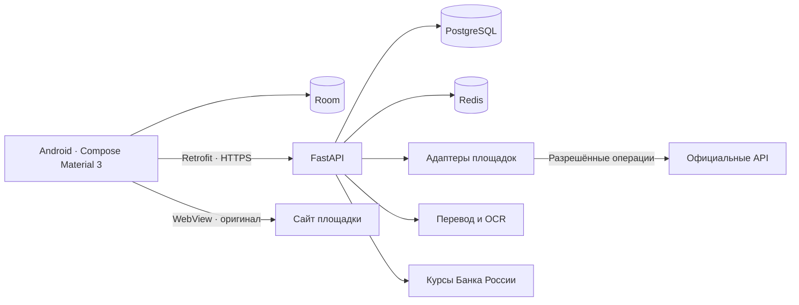

# Архитектура Kitai

Kitai помогает русскоязычному покупателю найти товар на Taobao, 1688 или Alibaba.com, сравнить предложения и открыть оригинальную карточку у продавца. Покупатель видит площадку, дату получения данных и количество товара, для которого действует цена.

Документ задаёт целевое поведение. Выполненные проверки и ограничения конкретной версии указываются в её отчёте. Условия подключения и доступный ассортимент каждой площадки описываются в `docs/marketplaces/`.

## Компоненты

**На Android** экран Compose получает состояние из `ViewModel`. Репозиторий загружает данные через Retrofit, сохраняет разрешённые снимки и сообщает UI об изменениях через `Flow`. Hilt предоставляет сетевой клиент, DAO и репозитории. Room хранит локальные закладки, историю просмотров и выбранные для сравнения предложения. Сохранённая карточка доступна в режиме полёта вместе с датой получения. [Android Developers, хранение данных для автономной работы](https://developer.android.com/topic/architecture/data-layer/offline-first)

**На сервере** FastAPI проверяет параметры, выбирает доступные адаптеры, объединяет ответы и применяет одинаковые правила цены и фильтрации. За каждым адаптером закреплены конкретные разрешения, например поиск или получение деталей. PostgreSQL хранит разрешённые к сохранению сведения с датами наблюдения, курсы и версию схемы. Redis ускоряет повторные чтения и координирует ограничения частоты. Перезапуск Redis сохраняет постоянные данные в PostgreSQL и на устройстве.

**На стороне продавца** пользователь просматривает оригинальную страницу. Авторизацию, корзину и оплату обслуживает сама площадка. Приложение разбирает URI, проверяет HTTPS и хост по списку площадки при открытии и последующих переходах. Следует блокировать локальные схемы, файловый доступ, смешанный HTTP-контент и мост JavaScript к Android. Для неподдерживаемой навигации пользователь может открыть разрешённую HTTPS-ссылку в браузере. [Android Developers, проверка URI](https://developer.android.com/privacy-and-security/risks/unsafe-uri-loading) · [Android Developers, мосты WebView](https://developer.android.com/privacy-and-security/risks/insecure-webview-native-bridges)

## Границы доступа к площадкам

Taobao, 1688 и Alibaba.com получают устойчивые идентификаторы `taobao`, `1688`, `alibaba`. Права на партнёрский ассортимент, поиск, подробности и изображения подтверждаются для конкретного приложения и операции. Предложение поставщика на Alibaba.com и партнёрская карточка Taobao могут иметь разные условия цены, заказа, хранения и публикации.

| Состояние источника | Что известно клиенту |
| --- | --- |
| `available` | В справочнике подключение проверено для заявленной возможности. В ответе поиска площадка успешно обработала этот запрос. Пустая выдача в этом случае означает отсутствие совпадений. |
| `configured` | Реквизиты заданы, успешного ответа площадки за время работы backend ещё не было. Поиск может проверить доступ. |
| `not_configured` | Для источника отсутствуют настроенное подключение или данные доступа. Доступна ссылка на официальный сайт. |
| `unsupported` | Запрошенная операция отсутствует в разрешённых возможностях источника. Например, доступ может распространяться только на поиск по непустому запросу. |
| `forbidden` | Площадка отклонила авторизацию или право на операцию. Восстановление доступа выполняется на сервере. |
| `rate_limited` | Площадка ограничила частоту. Сервер учитывает разрешённое время повтора, клиент сохраняет уже полученные предложения. |
| `unavailable` | Сбой сети или сервиса помешал получить ответ за отведённое время. |

Агрегатор задаёт предельное время для каждой площадки. Он завершает запрос с результатами ответивших источников и состоянием остальных. Если у всех трёх источников отсутствует доступ, каталог показывает названия площадок, причины и ссылки. Фикстуры для проверки списка, фильтров и карточек хранятся в тестах. Снимок реального предложения содержит время получения и сохраняется в пределах условий источника. При истечении разрешённого срока клиент может сохранить пользовательскую закладку и ссылку, удалив просроченные данные площадки.

## Контракт Android и backend

Префикс пользовательского API — `/api/v1`. Даты наблюдения передаются в ISO 8601 с часовым поясом, дата действия курса в `YYYY-MM-DD`. Денежные значения передаются десятичными строками. Типы тела и ответы ошибок реализации публикует OpenAPI FastAPI. Общие примеры используются в тестах Retrofit и сервера.

| Операция | Запрос | Ответ |
| --- | --- | --- |
| Работоспособность | `GET /health` | `status` процесса API. Контроль доступности PostgreSQL проводится отдельно при развёртывании. |
| Площадки | `GET /api/v1/sources` | `sources[]` с полями `id`, `name`, `status`, `supports_search`, `supports_detail`, `homepage_url`. |
| Каталог и поиск | `GET /api/v1/search` | Обязательный непустой `q` длиной до 200 символов, повторяемый `source`, `limit` от 1 до 50 (по умолчанию 20), необязательный `cursor`. Ответ содержит `items[]`, `sources[]` с `id` и `status`, `next_cursor` или `null`. Начальный экран получает список площадок из `GET /api/v1/sources`. |
| Карточка | `GET /api/v1/products/{source}/{id}` | Одно предложение. Ключ состоит из площадки и идентификатора предложения внутри неё. |
| Курсы | `GET /api/v1/rates` | `base`, `date`, `rates`, `source`, `stale`. При `base=RUB` значение в `rates` показывает количество рублей за **одну единицу** указанной валюты. |
| Перевод текста | `POST /api/v1/translate` | JSON с `text`, `source_lang`, `target_lang`. Поле `text` ответа содержит перевод, `engine` обозначает использованный движок. |
| Перевод изображения | `POST /api/v1/ocr` | Multipart с `file`, `source_lang`, `target_lang`. Ответ содержит размеры изображения и `blocks[]` с оригиналом `text`, `translation` и прямоугольником `box` в пикселях. |

Смена запроса или состава площадок сбрасывает курсор. Локальные сортировка и фильтры применяются к уже загруженным данным. Курсор привязан к параметрам исходной выдачи. Репозиторий Android отбрасывает запоздавший ответ на предыдущий запрос. Совпадение идентификаторов внутри разных площадок допустимо. Предложения с похожими названиями и картинками сохраняют собственные ссылки, цены и продавцов.

### Карточка и сравнение

Обязательные поля предложения — `source`, `id`, `title` (оригинальное название), `url` (HTTPS-карточка) и `observed_at`. Заполняемые по наличию поля — `title_ru`, `image_url`, `price_min`, `price_max`, `currency`, `price_rub`, `fx_date`, `seller`, `moq`. Приложение показывает оригинальное название, если перевод отсутствует. В сравнении остаются видны источник, количество, валюта и неизвестные значения. Оптовые ступени и варианты поставки сохраняются при наличии соответствующих прав и данных. Доставка и сборы учитываются только при наличии отдельных подтверждённых сумм.

`price_rub` представляет оценку для `price_min`. Для диапазона сохраняются обе исходные границы и показывается рублёвая оценка нижней границы. Сервис запрашивает ежедневные котировки Банка России, делит `Value` на `Nominal` и умножает исходную цену на результат в десятичной арифметике. Округление выполняется при выводе. Например, при **условном** курсе 120 ₽ за 10 единиц товар за 18,50 единиц стоит ориентировочно 222,00 ₽. Дата из документа Банка России и дата получения предложения отображаются раздельно. При недоступном курсе остаётся оригинальная цена, ранее сохранённый курс сопровождается датой. [Банк России, получение данных в XML](https://cbr.ru/development/sxml/)

## Перевод текста и изображения

Целевые направления — `ru → zh`, `zh → ru`, `en → ru`. Исходный текст остаётся доступен для проверки чисел, единиц, названий моделей и артикулов. Сервер может использовать локально установленные языковые пакеты. Для каждого направления перед включением проверяются пакет, лицензия, качество и расход памяти на целевой машине. Если используется промежуточный английский, в тестах проверяется вся цепочка. Ключ кеша включает исходный текст в виде хеша, языки, версию движка и модель. Отсутствующий движок сообщает о недоступности функции. [Argos Translate, пакеты и промежуточные языки](https://github.com/argosopentech/argos-translate/blob/master/docs/index.rst)

Пользователь выбирает изображение и запускает распознавание. Сервер проверяет тип, объём и размеры после декодирования, применяет ориентацию, распознаёт текст и переводит блоки. Координаты `[x, y, width, height]` отсчитываются от левого верхнего угла изображения указанного в ответе размера. Android масштабирует блоки вместе с изображением и даёт прочитать оригинал. Если распознавание удалось, а перевод недоступен, каждому такому блоку возвращается `translation=null`. Пустое изображение с доступным движком даёт пустой список блоков. Временные файлы удаляются после обработки, содержимое загрузок исключается из журналов. [Tesseract, распознавание и форматы вывода](https://tesseract-ocr.github.io/tessdoc/Command-Line-Usage.html)

## Размещение на Synology SA6400

Compose-проект включает FastAPI, PostgreSQL и Redis. Публичной точкой входа служит разрешённый пользователю HTTPS-адрес API через обратный прокси. PostgreSQL и Redis общаются с API по внутренней сети проекта. Секреты адаптеров передаются серверу при запуске. В логи попадают идентификатор запроса, код результата, длительность и состояние источника. Для подписанных ссылок и пользовательских изображений исключаются параметры доступа и содержимое. [Synology, проекты Container Manager](https://kb.synology.com/en-global/DSM/help/ContainerManager/docker_project)

Данные PostgreSQL располагаются на отдельном постоянном томе. Перед обновлением фиксируются версия схемы, digest образа и резервная копия. Проверка восстановления разворачивает копию в отдельном проекте, применяет совместимую версию приложения и читает контрольные записи. Для отката со сменой схемы сохраняется старая БД или предварительно проверенная копия. Версию DSM, Container Manager, архитектуру образа, свободное место и производительность OCR проверяют на конкретном NAS. [PostgreSQL, резервная копия и восстановление](https://www.postgresql.org/docs/current/backup-dump.html) · [Docker, готовность зависимостей](https://docs.docker.com/compose/how-tos/startup-order/)

Приёмка пользовательских сценариев и порядок выпуска описаны в [техническом задании и плане](implementation-plan.md).
